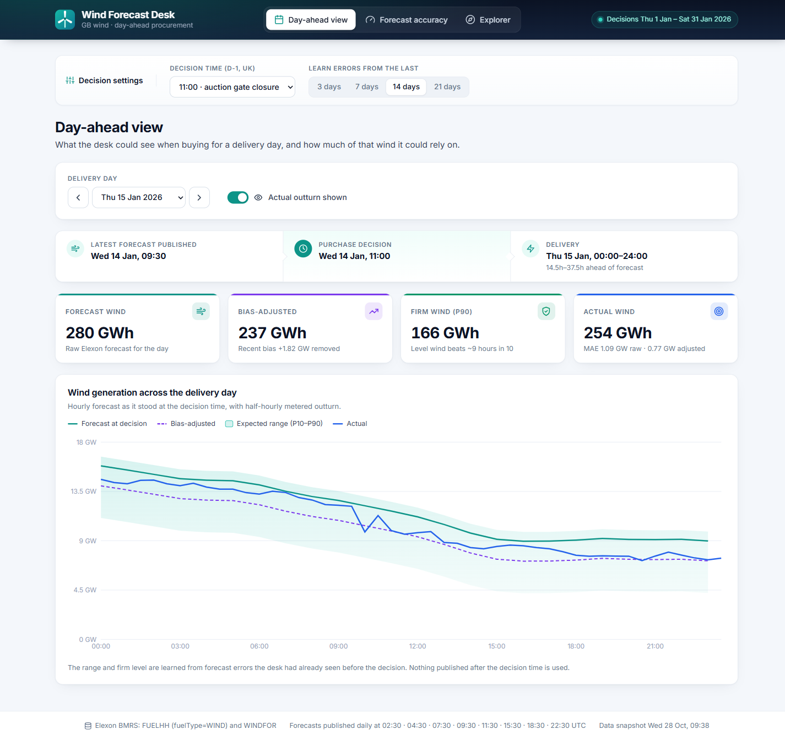
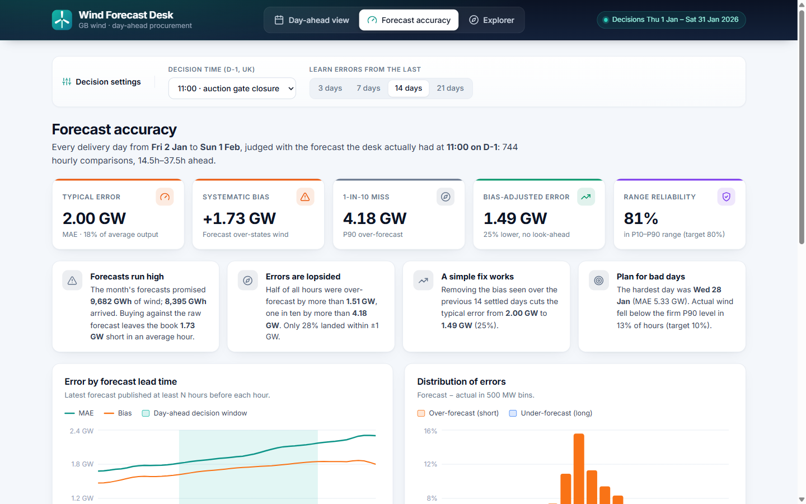
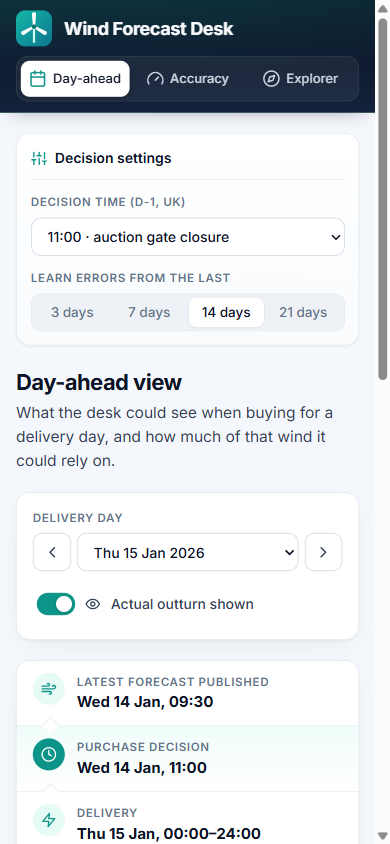

# Wind Forecast Desk

A web app for a UK energy supplier's day-ahead trading desk. It shows the **latest GB wind
generation forecast available when the day-ahead purchase is made**, and **measures how accurate
that forecast has been**, so the desk can decide how much power to buy beyond what wind is
expected to provide.

Scope (per the brief): national wind outturn and forecasts from Elexon only, for **purchase
decisions made in January 2026** (delivery days 2 Jan – 1 Feb 2026).

- **Live app:** https://gridbricks-kappa.vercel.app
- **Demo video:** _add the unlisted YouTube link here_



<table>
  <tr>
    <td width="72%"></td>
    <td width="28%"></td>
  </tr>
</table>

---

## What the app shows

| Tab | Question it answers |
| --- | --- |
| **Day-ahead view** | "At 11:00 yesterday, what did the forecast say for this delivery day, and how much wind could we really count on?" Shows the forecast as it stood at the decision time, a bias-adjusted forecast, a P10–P90 range and a "firm wind" (P90) level, with the actual outturn shown or hidden on demand. |
| **Forecast accuracy** | "How far can we trust the forecast?" MAE, RMSE, bias and error percentiles for every January decision, error by lead time, by hour of day and by day, and how much the bias adjustment helps. |
| **Explorer** | Any date range at any forecast horizon (0–48h): the latest forecast published at least *N* hours before each hour, compared with actuals. |

The decision time (default **11:00 UK on D-1**, GB day-ahead auction gate closure) and the
learning window (default 14 days) can be changed in the UI. Each view has its own URL
(`#day-ahead`, `#accuracy`, `#explorer`), so it can be bookmarked or shared.

The layout is responsive from 320 px phones to wide desktops: KPI tiles reflow, charts resize
and thin out their axis labels, and the navigation collapses to a compact tab bar.

### Headline findings (January 2026, 11:00 decision)

| Metric | Value |
| --- | --- |
| Hourly comparisons | 744 (31 delivery days × 24h) |
| Forecast used | the 09:30 publication, 14.5–37.5h ahead of delivery |
| MAE / RMSE | 2.00 GW / 2.50 GW (MAE = 18% of mean wind output) |
| Bias (forecast − actual) | **+1.73 GW**: wind is systematically over-forecast |
| P50 / P90 error | +1.51 GW / +4.18 GW |
| Month energy | 9,682 GWh forecast vs 8,395 GWh delivered |
| Bias-adjusted MAE | **1.49 GW (−25%)**, using only errors known before each decision |
| P10–P90 range coverage | 81% (target 80%); actual below the firm P90 level 13% of hours (target 10%) |

Accuracy also degrades with lead time (MAE about 1.7 GW at 0h to 2.3 GW at 48h).

## Method

- **Error** = forecast − actual (MW). Positive means wind was over-forecast and the book is short.
- **Forecast at decision**: for each hourly target in delivery day D, the most recent WINDFOR
  forecast with `publishTime <= decision time` (UK local hour on D-1). Rows where
  `publishTime > startTime` are not forecasts and are discarded.
- **Matching**: WINDFOR targets are hourly; FUELHH actuals are half-hourly. Pairs are matched on
  the hourly `startTime`. Charts show the full half-hourly actuals.
- **No look-ahead learning**: before each decision, the app looks at the previous *N* delivery
  days whose actuals were complete at decision time (up to D-2) and computes the mean error
  (bias) and its 10th/90th percentiles. Then:
  - bias-adjusted forecast = forecast − bias
  - firm wind (P90) = forecast − P90 error; upside = forecast − P10 error
- **Horizon analysis**: for horizon *H*, the latest forecast published at least *H* hours before
  each target hour.
- **Time zones**: all calculations use UTC instants. Delivery days and decision times are
  defined in Europe/London time, so clock-change days (23h / 25h) are handled (unit tested).

### Assumptions and limitations

- FUELHH `WIND` and WINDFOR both cover transmission-metered wind. Embedded (distribution-connected)
  wind is not included, as the brief limits the data to these two datasets.
- Part of the positive bias is probably curtailment (constrained-off wind is forecast but not
  metered). The data used here cannot separate it, but the bias adjustment captures it in practice.
- Demand data is out of scope, so the app reports the wind side of the procurement need. The
  amount to buy is demand minus the wind level the desk chooses to rely on.

## Architecture

```
                 ┌────────────────────────── Docker image / Vercel ──────────────────────────┐
 Browser ──HTTP──▶  React SPA (Vite, TS, Recharts)   ──/api/*──▶  FastAPI (Python 3.12)       │
                 │  frontend/src                                  backend/app/main.py          │
                 │                                                   │                         │
                 │                                   analysis.py ◀───┘  pure functions:        │
                 │                                   pairing, stats, trailing error profile    │
                 │                                                   │                         │
                 │                                   elexon.py ──────┴─▶ data/*.json.gz snapshot│
                 └───────────────────────────────────────────────│───────────────────────────┘
                                                                 └─(refresh / DATA_SOURCE=live)─▶ Elexon BMRS API
```

- **Data**: January 2026 is historical, so the app ships a 170 KB gzipped snapshot of both
  datasets (`backend/data/`), with 23 extra days of history for the learning window. This keeps
  the deployed app fast and deterministic and avoids depending on Elexon at runtime. Set
  `DATA_SOURCE=live` to fetch from the API on startup instead, or run the snapshot script.
- **Backend**: all logic is in `analysis.py` as pure functions over an in-memory index
  (`WindData`, with a sorted publish-time index per target and `bisect` for "latest forecast as of
  t"). `main.py` only validates inputs; Pydantic response models (`schemas.py`) document every
  field in the OpenAPI spec and validate output. Results are cached in memory per parameter set,
  and responses carry `Cache-Control` headers (5 min for API data, immutable for hashed assets).
- **Frontend**: three lazily loaded views (Recharts is only fetched when a chart is shown), a
  small `useApi` hook (cancels stale requests, keeps previous data while reloading, retry on
  error), typed API models that mirror the backend, an error boundary per view, skeleton
  loading states, and UK-local time formatting throughout. Self-hosted Inter font and an inline
  icon set, so there are no runtime CDN dependencies.
- **One deployable**: in Docker the FastAPI app serves the built SPA as well as `/api`, so there
  is one image, one port and no CORS. On Vercel the SPA is static and `/api/*` is rewritten to a
  Python serverless function (`api/index.py`) that wraps the same app.

## Repository layout

```
.
├── backend/
│   ├── app/
│   │   ├── config.py        # scope (Jan 2026), market conventions, data source settings
│   │   ├── elexon.py        # Elexon BMRS client (chunked, retried) + snapshot read/write
│   │   ├── analysis.py      # forecast/actual pairing, error statistics, views served by the API
│   │   ├── schemas.py       # Pydantic response models (OpenAPI docs)
│   │   └── main.py          # FastAPI routes, caching headers; serves the built frontend
│   ├── data/
│   │   └── elexon_wind_jan2026.json.gz   # committed data snapshot
│   ├── scripts/snapshot.py  # refresh the snapshot from the live API
│   ├── tests/               # pytest: unit tests (synthetic data) + API tests (snapshot)
│   ├── requirements.txt / requirements-dev.txt
│   └── pyproject.toml       # pytest + ruff config
├── frontend/
│   ├── src/
│   │   ├── App.tsx          # shell: header, URL-hash tabs, shared decision settings
│   │   ├── api.ts           # typed API models + useApi hook
│   │   ├── format.ts        # number/date formatting (Europe/London) + format.test.ts
│   │   ├── hooks.ts         # useMediaQuery / useIsMobile / useDebounced
│   │   ├── theme.ts         # chart colours and axis styling
│   │   ├── styles.css       # design tokens, components, responsive breakpoints
│   │   └── components/      # DayAhead, Accuracy, Explorer, ui, icons, ErrorBoundary
│   ├── eslint.config.js, .prettierrc.json
│   ├── index.html, vite.config.ts, tsconfig.json, package.json
├── api/index.py             # Vercel serverless entry (imports backend/app)
├── vercel.json, .vercelignore, requirements.txt   # Vercel config (mirrors backend deps)
├── Dockerfile, docker-compose.yml, .dockerignore   # single-image build
├── heroku.yml               # Heroku container deploy
├── docs/
│   ├── DEMO_SCRIPT.md       # outline for the two-part demo video
│   └── screenshots/
├── .editorconfig, .gitattributes
└── .github/workflows/ci.yml # lint, format, tests (backend + frontend), build, Docker smoke test
```

## Running it

### With Docker (recommended)

```bash
docker compose up --build
# open http://localhost:8000
```

### Locally for development

Backend (Python 3.12):

```bash
cd backend
python -m venv .venv
# Windows: .venv\Scripts\activate    macOS/Linux: source .venv/bin/activate
pip install -r requirements-dev.txt
uvicorn app.main:app --reload --port 8000     # API docs at http://localhost:8000/docs
```

Frontend (Node 22+), in a second terminal:

```bash
cd frontend
npm install
npm run dev            # http://localhost:5173, proxies /api to :8000
```

### Tests and checks

```bash
cd backend && pytest -q && ruff check . && ruff format --check .
cd frontend && npm run lint && npm run format:check && npm test && npm run build
```

### Refreshing the data

```bash
cd backend && python -m scripts.snapshot
```

## API

| Endpoint | Description |
| --- | --- |
| `GET /api/meta` | Scope, defaults, forecast publication schedule, snapshot time |
| `GET /api/day-ahead?delivery_day=2026-01-15&decision_hour=11&lookback_days=14` | One delivery day as seen at the decision: series, energy totals, error stats |
| `GET /api/accuracy?decision_hour=11&lookback_days=14` | Month-level accuracy report (overall, by horizon, hour of day, day, histogram) |
| `GET /api/explorer?start=2026-01-08&end=2026-01-14&horizon_h=4` | Actual vs forecast at a fixed minimum horizon |
| `GET /api/health` | Liveness |

Interactive OpenAPI docs are at `/docs`.

### Configuration

| Variable | Default | Purpose |
| --- | --- | --- |
| `DATA_SOURCE` | `snapshot` | `snapshot` loads `backend/data`; `live` fetches from Elexon at startup |
| `PORT` | `8000` | Port the container listens on (set by Heroku) |
| `ALLOWED_ORIGINS` | empty | Comma-separated origins for CORS; not needed when the frontend is same-origin |
| `API_URL` | `http://localhost:8000` | Dev only: where the Vite dev server proxies `/api` |

## Deployment

**Vercel**: import the repo (or run `vercel --prod` from the root). `vercel.json` builds the
frontend, serves it statically and routes `/api/*` to `api/index.py`, which bundles
`backend/app` and the data snapshot.

**Heroku** (container stack):

```bash
heroku create <app-name> --stack container
git push heroku main
```

`heroku.yml` builds the same Dockerfile; the container listens on `$PORT`.
